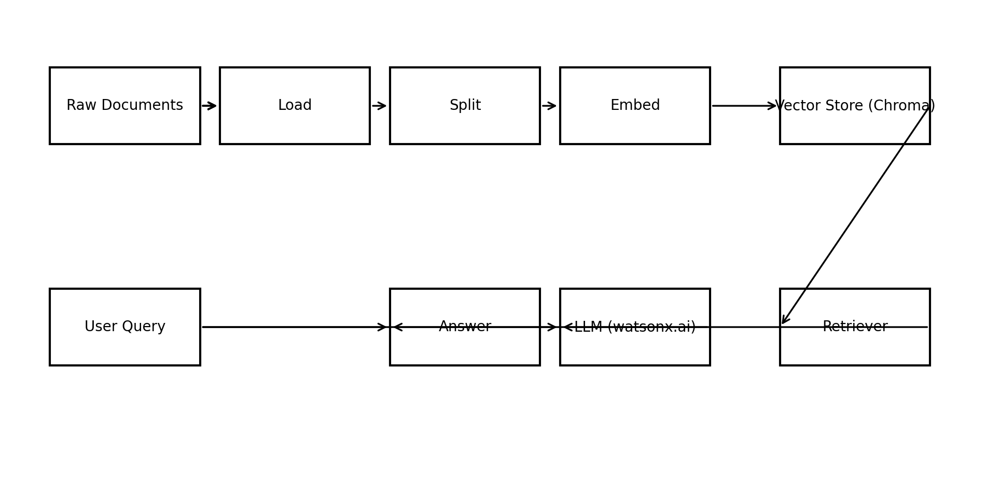
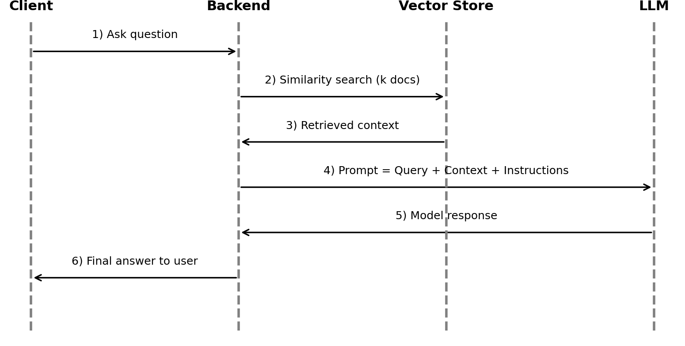

# End-to-End Guide: Summarizing Private Documents Using RAG, LangChain, and LLMs

*Author: Saif Ullah \| Date: 18-Feb-2026*

## Executive Summary

This guide provides a production-grade, step-by-step blueprint to build a Retrieval-Augmented Generation (RAG) system for summarizing and querying private documents. It covers architecture, setup, complete Python examples, prompting, conversational memory, deployment patterns, performance tuning, evaluation, and troubleshooting.

## 1. Architecture Overview

RAG combines a vector database for retrieval with an LLM for generation. The pipeline has two phases:

- Indexing (offline): Load → Split → Embed → Store in Vector DB (Chroma).

- Retrieval & Generation (online): Retrieve relevant chunks → Compose prompt with query + context → Generate answer.

Figure 1: High-level RAG architecture.



Figure 2: Request–response sequence for a RAG query.



Figure 3: Reference deployment for a backend service using Chroma + watsonx.ai.


## 2. Environment Setup

Install the required libraries (pin versions for reproducibility):

```bash
# Shell (do not run inside Python directly)
pip install ibm-watsonx-ai==0.2.6 \
            langchain==0.1.16 \
            langchain-ibm==0.1.4 \
            transformers==4.41.2 \
            huggingface-hub==0.23.4 \
            sentence-transformers==2.5.1 \
            chromadb \
            wget==3.2 \
            --upgrade torch --index-url https://download.pytorch.org/whl/cpu
```

Recommended hardware: CPU is fine for small corpora; a GPU accelerates embedding & model inference. Keep Python ≥3.10.

## 3. Complete Working Example

The following end-to-end example shows how to build a local RAG app over a text file using Chroma and watsonx.ai.

### 3.1 Imports and Configuration

```python
# Standard hygiene: suppress noisy warnings
import warnings
warnings.filterwarnings('ignore')

# LangChain & friends
from langchain.document_loaders import TextLoader
from langchain.text_splitter import CharacterTextSplitter
from langchain.vectorstores import Chroma
from langchain.embeddings import HuggingFaceEmbeddings
from langchain.chains import RetrievalQA
from langchain.prompts import PromptTemplate
from langchain.chains import ConversationalRetrievalChain
from langchain.memory import ConversationBufferMemory

# IBM watsonx.ai
from ibm_watsonx_ai.foundation_models import Model
from ibm_watsonx_ai.metanames import GenTextParamsMetaNames as GenParams
from ibm_watsonx_ai.foundation_models.utils.enums import DecodingMethods
from ibm_watson_machine_learning.foundation_models.extensions.langchain import WatsonxLLM

# Utilities
import os, wget
```

### 3.2 Load a Sample Document

```python
filename = 'companyPolicies.txt'
url = 'https://cf-courses-data.s3.us.cloud-object-storage.appdomain.cloud/6JDbUb_L3egv_eOkouY71A.txt'
if not os.path.exists(filename):
    wget.download(url, out=filename)
print('File ready:', filename)

loader = TextLoader(filename)
documents = loader.load()
print('Loaded', len(documents), 'document(s)')
```

### 3.3 Split into Chunks

Tune chunk_size and chunk_overlap to balance retrieval recall vs. context fit.

```python
text_splitter = CharacterTextSplitter(
    separator='\n\n',   # paragraph-aware
    chunk_size=1000,
    chunk_overlap=100,
)
texts = text_splitter.split_documents(documents)
print('Chunks:', len(texts))
```

### 3.4 Embed & Persist in Chroma

```python
# Choose a compact, high-quality embedding model
embeddings = HuggingFaceEmbeddings(model_name='sentence-transformers/all-MiniLM-L6-v2')

# Persist to disk so the index can be reused
persist_dir = 'chroma_index'
vectorstore = Chroma.from_documents(texts, embeddings, persist_directory=persist_dir)
vectorstore.persist()
print('Vector store persisted at', persist_dir)
```

### 3.5 Initialize watsonx.ai LLM

```python
model_id = 'ibm/granite-3-3-8b-instruct'  # example; choose any supported instruct model
params = {
    GenParams.DECODING_METHOD: DecodingMethods.GREEDY,
    GenParams.MAX_NEW_TOKENS: 256,
    GenParams.MIN_NEW_TOKENS: 64,
    GenParams.TEMPERATURE: 0.2,
}
credentials = {
    'url': 'https://us-south.ml.cloud.ibm.com'
    # 'api_key': 'YOUR_KEY'  # uncomment when running locally
}
project_id = 'skills-network'  # replace with your project when running locally

model = Model(model_id=model_id, params=params, credentials=credentials, project_id=project_id)
llm = WatsonxLLM(model=model)
```

### 3.6 RetrievalQA with Guardrails Prompt

```python
retriever = vectorstore.as_retriever(search_kwargs={'k': 4})

prompt_template = (
    "Use the information from the context to answer the question.\n"
    "- If the answer is not in the context, say: 'I do not know'.\n"
    "- Be concise and cite policy names if available.\n\n"
    "Context:\n{context}\n\nQuestion: {question}\nAnswer:"
)
PROMPT = PromptTemplate(template=prompt_template, input_variables=['context', 'question'])

qa = RetrievalQA.from_chain_type(
    llm=llm,
    chain_type='stuff',
    retriever=retriever,
    chain_type_kwargs={'prompt': PROMPT},
    return_source_documents=True,
)

print(qa.invoke({'query': 'What is the mobile policy?'}))
```

### 3.7 Conversational Retrieval with Memory

```python
memory = ConversationBufferMemory(memory_key='chat_history', return_messages=True)
conv = ConversationalRetrievalChain.from_llm(
    llm=llm,
    chain_type='stuff',
    retriever=retriever,
    memory=memory,
    get_chat_history=lambda h: h,
    return_source_documents=True,
)

result = conv.invoke({'question': 'Summarize the smoking policy.'})
print(result['answer'])
result = conv.invoke({'question': 'List its key points.'})
print(result['answer'])
```

### 3.8 CLI Agent (Optional Demo)

```python
def run_agent():
    print("Type 'exit' to quit.")
    history = []
    while True:
        q = input('Question: ').strip()
        if q.lower() in {'exit', 'quit', 'bye'}:
            print('Goodbye!')
            break
        out = conv.invoke({'question': q})
        print('Answer:', out['answer'])
        history.append((q, out['answer']))

# run_agent()
```

## 4. Prompt Engineering Tips

- State strict fallback behavior (e.g., “I do not know”).

- Constrain style: length, tone, citation format.

- Provide examples of good/poor answers to shape outputs (few-shot).

- Log prompts and outcomes to iteratively refine templates.

## 5. Evaluation & Quality

1.  Retrieval: Track Recall@k and MRR using labeled queries.

2.  Faithfulness: Verify answers are supported by retrieved text (spot-check or automated).

3.  Latency: Measure end-to-end time; cache embeddings and enable persistent vector stores.

4.  Cost: Prefer smaller embedding models; limit k and chunk sizes; reuse contexts.

## 6. Performance Tuning

- Chunking: Try 500–1200 characters, overlap 50–150 depending on document style.

- Embeddings: Use domain-tuned embeddings for better recall when available.

- Hybrid search: Combine dense (vector) with keyword filtering for precision.

- Reranking: Optionally re-order retrieved chunks using a cross-encoder.

- Caching: Persist Chroma and memoize frequent queries.

## 7. Security & Privacy

- Keep private data local in your vector store; avoid sending raw documents to third-party services.

- Redact/Mask PII where possible before indexing.

- Use a secrets manager for API keys; rotate keys and restrict scope.

- Log prompts/answers without storing sensitive content (or encrypt logs).

## 8. Troubleshooting

- Hallucinations: Tighten the prompt; lower temperature; return_source_documents=True for transparency.

- Irrelevant answers: Increase k or reduce chunk_size; ensure clean separators; consider overlap.

- Empty retrievals: Verify embeddings model; re-index; normalize text (lowercase, strip boilerplate).

- API errors: Check credentials, region, and project configuration for watsonx.ai.

## 9. Glossary

- RAG: Retrieval-Augmented Generation.

- Embedding: Numeric vector representation of text for similarity search.

- Vector Store: Database for vectors enabling nearest-neighbor search.

- Prompt Template: Parameterized instruction for the LLM.

- Memory: Mechanism to maintain conversation context across turns.

## Appendix A: Minimal Script (Copy-Paste Ready)

```python
# Minimal RAG over local text
from langchain.document_loaders import TextLoader
from langchain.text_splitter import CharacterTextSplitter
from langchain.vectorstores import Chroma
from langchain.embeddings import HuggingFaceEmbeddings
from langchain.chains import RetrievalQA
from langchain.prompts import PromptTemplate
from ibm_watsonx_ai.foundation_models import Model
from ibm_watsonx_ai.metanames import GenTextParamsMetaNames as GenParams
from ibm_watsonx_ai.foundation_models.utils.enums import DecodingMethods
from ibm_watson_machine_learning.foundation_models.extensions.langchain import WatsonxLLM

loader = TextLoader('companyPolicies.txt')
docs = loader.load()
splitter = CharacterTextSplitter(chunk_size=1000, chunk_overlap=100)
chunks = splitter.split_documents(docs)
emb = HuggingFaceEmbeddings(model_name='sentence-transformers/all-MiniLM-L6-v2')
vs = Chroma.from_documents(chunks, emb)

model = Model(
    model_id='ibm/granite-3-3-8b-instruct',
    params={GenParams.DECODING_METHOD: DecodingMethods.GREEDY, GenParams.MAX_NEW_TOKENS: 256},
    credentials={'url': 'https://us-south.ml.cloud.ibm.com'},
    project_id='skills-network'
)
llm = WatsonxLLM(model=model)

prompt = PromptTemplate(
    template=('Answer using only the context. If unknown, say "I do not know".\n\nContext:\n{context}\n\nQuestion: {question}\nAnswer:'),
    input_variables=['context', 'question']
)
qa = RetrievalQA.from_chain_type(llm=llm, chain_type='stuff', retriever=vs.as_retriever(), chain_type_kwargs={'prompt': prompt})
print(qa.invoke({'query': 'Summarize the mobile policy.'}))
```
